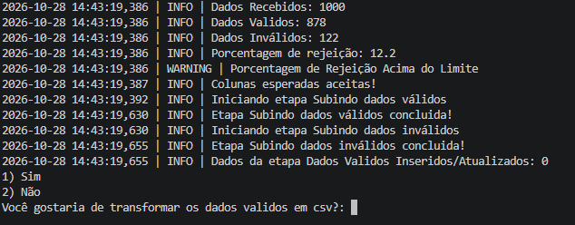

# Pipeline ETL de Funcionários

Projeto de engenharia de dados em Python: uma **API REST (FastAPI)** expõe dados de um banco **PostgreSQL**, e um **pipeline ETL** consome essa API, valida e trata os dados com **Pandas** e os grava de volta no banco de forma segura, com logs e métricas de qualidade em cada etapa.

> Todos os dados deste projeto são **fictícios**, gerados com auxílio de IA.

## Visão geral do fluxo

```
PostgreSQL (tabela dados)
        │
        ▼
API FastAPI (GET /dados)
        │
        ▼
ETL: Requests → Pandas (limpeza e validação)
        │
        ├─► funcionario_valido   (upsert)
        └─► funcionario_invalido (registros rejeitados)
        │
        ▼
Exportação opcional para CSV
```

## Como o projeto foi construído

1. **Banco de dados:** criei o banco `funcionarios` no PostgreSQL e populei a tabela `dados` com informações fictícias de funcionários (id, nome, e-mail, CPF e data de nascimento).
2. **API REST:** com FastAPI e SQLAlchemy, criei o endpoint `GET /dados`, que conecta ao banco e devolve os registros em JSON.
3. **Extração:** o script ETL consome o endpoint com `requests` e transforma a resposta em um DataFrame do Pandas.
4. **Transformação:**
   - padronização de nomes (`title` + `strip`) e e-mails (`lower` + `strip`)
   - conversão de datas, com datas inválidas tratadas como nulas
   - verificação das colunas esperadas
5. **Validação:** uma regra única de tratamento separa os registros em válidos e inválidos. Um registro é rejeitado quando tem:
   - `id` nulo, negativo ou duplicado
   - nome nulo
   - CPF nulo ou duplicado
   - data de nascimento nula, anterior a 1930 ou posterior a 2024
6. **Carga:** o SQLAlchemy grava os válidos em `funcionario_valido` com **upsert** (`ON CONFLICT`), que evita duplicidade e só atualiza o registro quando nome ou e-mail realmente mudaram. Os rejeitados vão para `funcionario_invalido`, para análise posterior.
7. **Observabilidade:** o pipeline usa `logging` e informa no terminal, a cada execução:
   - dados recebidos, válidos e inválidos
   - porcentagem de rejeição, com **alerta** se passar de 10%
   - início, conclusão e erros de cada etapa
   - quantidade de registros inseridos ou atualizados
8. **Interação final:** ao terminar, o programa pergunta se você quer exportar os dados válidos para `dados_validos.csv` ou apenas encerrar após a atualização.

## Tecnologias

Python · FastAPI · Uvicorn · SQLAlchemy · PostgreSQL · Pandas · Requests · python-dotenv

## Segurança

- Credenciais do banco em variáveis de ambiente (`.env`), nunca no código
- `.env` e arquivos gerados listados no `.gitignore`
- `.env.example` documenta as variáveis necessárias
- Consultas SQL parametrizadas, que protegem contra SQL injection

## Como rodar

1. Clone o repositório e instale as dependências:
   ```bash
   pip install -r requirements.txt
   ```
2. Copie `.env.example` para `.env` e preencha com os dados do seu banco.
3. Suba a API:
   ```bash
   python -m uvicorn main:app --reload
   ```
4. Em outro terminal, rode o ETL:
   ```bash
   python restapi.py
   ```
 ## Exemplo de execução



## Autor

Pedro Augusto · [LinkedIn](https://www.linkedin.com/in/pedro-augusto-9197ba3ab/)